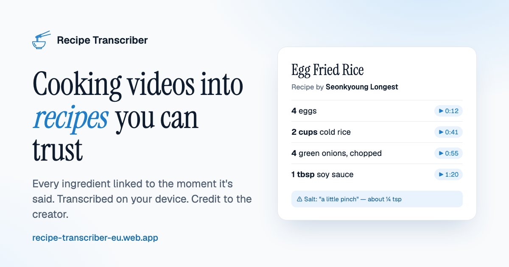
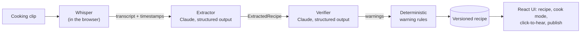

<div align="center">

# Recipe Transcriber

**Turn a cooking video's audio into a structured recipe you can trust: every ingredient is
linked to the moment it was said, nothing is made up, and anything uncertain is flagged.**

[](https://github.com/KennyHc/audio-recipe-transcriber/actions/workflows/ci.yml)




**Live:** [recipe-transcriber-eu.web.app](https://recipe-transcriber-eu.web.app)

</div>

## What it does

- **Audio in, recipe out.** Drop in a short cooking clip; get a title, ingredients with
  quantities and units, ordered steps, and tips.
- **Speech-to-text runs on your device.** Whisper runs in the browser (WebGPU, with a WASM
  fallback) through transformers.js, so audio never leaves your machine. Only the transcript is
  sent for extraction.
- **Two-agent extraction.** An *extractor* model turns the transcript into a typed recipe; a
  separate *verifier* model checks it against the transcript and raises warnings.
- **Never invents quantities.** Anything not traceable to what was said is marked `inferred` and
  shown without a number. A deterministic rules pass runs after the models to catch missing
  amounts ("a little pinch"), drop false alarms, and merge duplicate warnings.
- **Click to hear.** Every ingredient and step carries the timestamp it came from; press it to
  replay that moment of the clip.
- **Fix the source, not the symptom.** Edit the transcript where Whisper misheard and re-run
  extraction. Every edit is a new version, with history and rollback.
- **Cook mode.** Servings scaler and metric/imperial toggle that also rewrite the numbers inside
  step text, step-by-step view, timers, and a shopping list across recipes.
- **Accounts and a public recipe bank.** Sign in (Google or email link) to keep recipes across
  devices, then publish with credit to the original creator and video. Others can browse,
  search, save and cook public recipes.
- **Guard rails for a hosted LLM app.** Per-account monthly quota, a global daily spend budget
  enforced server-side, App Check / Turnstile bot checks, moderation and reporting, and a build
  step that fails if an API key ever lands in the client bundle.

## How it works



The prompts and Zod schemas live in [`shared/`](shared), the single contract imported by every
runtime, so the same pipeline runs in four modes chosen at build time:

| Mode | Transcription | Claude call | Storage |
| --- | --- | --- | --- |
| `server` (local dev) | `whisper-cli` via ffmpeg | local Node server ([`server/`](server)) | files under `data/` |
| `browser` | Whisper in the browser | direct, with your own API key | IndexedDB |
| `hosted` (anonymous) | Whisper in the browser | Cloudflare Worker proxy ([`worker/`](worker)) | IndexedDB |
| `cloud` (signed in, live) | Whisper in the browser | Cloud Run API ([`api/`](api)) | Firestore |

## How it's built

| Layer | Choice |
| --- | --- |
| Web | React 19, TypeScript, Vite, Tailwind, Radix / shadcn/ui, IndexedDB (`idb`) |
| Speech | Whisper (large-v3-turbo / small / base) via `@huggingface/transformers`; `whisper.cpp` locally |
| LLM | Anthropic SDK structured outputs (`messages.parse` + Zod), extractor and verifier models set by env |
| API | Hono on Cloud Run ([`api/`](api)), Cloudflare Worker for the anonymous mode ([`worker/`](worker)) |
| Data and auth | Firebase Auth, Firestore with security rules and rules tests ([`firebase/`](firebase)) |
| Quality | Vitest unit + emulator tests, an eval harness with rubric scoring over real clips ([`eval/`](eval)) |
| CI | GitHub Actions: secret scan, typecheck, tests, Firestore emulator tests, hosted build check |

## Run it locally

Requirements: Node 24, `ffmpeg` and `whisper.cpp` (`whisper-cli`) for the local server mode.

```bash
npm install
cp .env.example .env          # set CLAUDE_BACKEND=api and ANTHROPIC_API_KEY, or use the local claude CLI
npm run setup:whisper         # downloads the Whisper model into models/
npm run dev                   # server on :8787, web on http://localhost:5180
```

Other useful commands:

```bash
npm test                                         # all workspaces
npm run typecheck
npm run extract -w server -- transcript.json     # extract + verify a transcript, no audio needed
npm run eval                                     # score the pipeline against eval/cases
npm run dev:browser -w web                       # fully in-browser mode
```

The signed-in version runs against the Firebase emulators: see [DEPLOY.md](DEPLOY.md) for the
emulator and deploy setup.

## Project notes

Design and planning docs kept alongside the code: [PHASE1-PLAN.md](PHASE1-PLAN.md) (accounts),
[PHASE2-PLAN.md](PHASE2-PLAN.md) (publishing and the public bank),
[SAAS-PLAN.md](SAAS-PLAN.md), [IMPROVEMENTS.md](IMPROVEMENTS.md) and
[LAUNCH-NOTES.md](LAUNCH-NOTES.md).

## License

[MIT](LICENSE)
